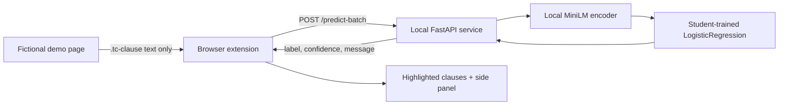

# ClauseGuard

**Registration takes seconds. Reading the agreement takes minutes. ClauseGuard gives users an attention layer before they click Accept.**

ClauseGuard is a student-hackathon prototype: a Chrome/Edge browser extension that scans the Terms and Conditions displayed on a (fictional) signup page and flags clauses that may deserve attention, using a locally running FastAPI service, a local MiniLM sentence encoder, and a student-trained Logistic Regression classifier.

> This is an educational ML prototype, not legal advice and not a production legal-analysis system. All training data is synthetic. All inference runs locally — there is no paid API, no LLM API, and no cloud dependency.

## 1. Project overview

- **Backend**: FastAPI service that loads a local MiniLM encoder + a Logistic Regression classifier once at startup, and exposes `/health`, `/model-info`, `/predict`, `/predict-batch`.
- **Model**: `sentence-transformers/all-MiniLM-L6-v2` embeddings + `scikit-learn` `LogisticRegression`, trained on 200 synthetic clauses (50 per class).
- **Demo sites**: six polished fictional signup journeys (streaming, shopping, fitness, gaming, cloud storage, online learning) plus a Scenario Lab gallery, a cross-scenario Comparison Dashboard, and a Hackathon Presentation page.
- **Extension**: Manifest V3 extension with two complementary modes:
  - **Demo mode**: reads only explicit `.tc-clause` elements on the fictional sites. Ticking the page's "I have reviewed the Terms" checkbox automatically triggers a scan (one `/predict-batch` request), highlights clauses, shows a prominent attention popup, and renders a side panel with category counts and a prototype attention score.
  - **Real-site dashboard mode**: click-to-scan only (never automatic). Click the toolbar icon, click **Scan Terms & Privacy Policy**, and a dashboard page opens with a simple grade and a category breakdown loosely mapped to themes in India's Digital Personal Data Protection Act, 2023. Only works for domains that have a pre-built cache (see [section 24](#24-real-site-dashboard-click-to-scan-only)) - nothing is fetched live from arbitrary sites.

## 1a. Real-site dashboard: click-to-scan, never automatic

Beyond the fictional demo sites, the extension can check a **real** website's Privacy Policy / Terms of Service against a pre-built cache and show a simple grade:

1. You click the ClauseGuard toolbar icon.
2. You click **Scan Terms & Privacy Policy**.
3. If the current site's domain has a pre-built cache, a dashboard tab opens showing a grade (A-D), a plain-language summary, and a category breakdown.
4. If it doesn't, you get an honest "not cached yet" message - nothing is silently fetched from the live internet.

This never runs on its own while you browse. See section 24 for the full architecture, the modular data pipeline for adding new sites, and the India-DPDP-themed category mapping.


## 2. Problem statement

Digital services make joining easy, but agreements may contain recurring payments, information-sharing permissions, dispute restrictions and account-control provisions that users may not notice before accepting. ClauseGuard does not replace reading the agreement — it gives users a reason to pause and shows them where to begin.

## 3. Architecture



## 4. Repository structure

```text
clauseguard/
|-- backend/
|   |-- app/            FastAPI app (main.py, schemas.py, model_service.py)
|   |-- data/clauses.csv   200 synthetic labelled clauses
|   |-- data/realsite_cache  caches of github,facebook,instagram
|   |-- models/           trained artifacts (generated by train_model.py)
|   |-- scripts/train_model.py
|   |-- tests/           pytest suite
|   `-- requirements.txt
|-- extension/           Manifest V3 Chrome/Edge extension
|-- demo/                fictional scenario websites + demo server
|-- playwright-tests/    end-to-end tests driving the real extension
|-- Dockerfile, compose.yaml, .dockerignore, Makefile
`-- README.md
```

## 5. How MiniLM embeddings work (high level)

MiniLM converts a sentence into a fixed-length numeric vector (an embedding) that captures its meaning. Sentences with similar meaning end up with similar vectors, even if they use different words. This lets a simple classifier work on "meaning" rather than exact keyword matches.

## 6. How Logistic Regression training works (high level)

Each labelled clause is converted to a MiniLM embedding. Logistic Regression then learns a linear decision boundary in that embedding space for each of the four classes, and `predict_proba` gives a confidence score for the predicted class.

**Why `C=5.0`, not the scikit-learn default `C=1.0`:** `C` controls regularization strength (inverse of it, technically) — lower `C` keeps decision boundaries conservative/smoother (and confidence scores closer to uniform across classes), higher `C` lets the model fit the training data more tightly (sharper, more confident predictions, at some risk of overfitting a small dataset). We measured accuracy and mean prediction confidence across `C ∈ [0.5, 50]` on the held-out test split and chose `C=5.0`: it matches the `C=1.0` baseline's measured accuracy (90%) while raising mean confidence from ~0.57 to ~0.72 — a real trade-off made deliberately and measured, not an arbitrary tweak. See `backend/scripts/train_model.py` for the comment documenting this.

## 7. Synthetic data

`backend/data/clauses.csv` contains 200 synthetic, clearly fictional clauses (50 per class: `SAFE`, `PRIVACY_RISK`, `PAYMENT_RISK`, `USER_RIGHTS_RISK`), each written with genuine lexical variation rather than templated repeats.

## 8. Prerequisites

- Python 3.11
- Google Chrome or Microsoft Edge
- (Optional) Docker or Podman

## 9. Native setup — macOS/Linux

```bash
cd clauseguard
python3.11 -m venv .venv
source .venv/bin/activate
python -m pip install --upgrade pip
pip install -r backend/requirements.txt
python backend/scripts/train_model.py
uvicorn backend.app.main:app --host 127.0.0.1 --port 8000 --reload
```

Second terminal:

```bash
cd clauseguard
source .venv/bin/activate
python demo/serve_demo.py
```

## 10. Native setup — Windows PowerShell

```powershell
cd clauseguard
py -3.11 -m venv .venv
.venv\Scripts\Activate.ps1
python -m pip install --upgrade pip
pip install -r backend\requirements.txt
python backend\scripts\train_model.py
uvicorn backend.app.main:app --host 127.0.0.1 --port 8000 --reload
```

Second terminal:

```powershell
cd clauseguard
.venv\Scripts\Activate.ps1
python demo\serve_demo.py
```

URLs:

- API: `http://127.0.0.1:8000`
- Swagger: `http://127.0.0.1:8000/docs`
- Scenario gallery: `http://127.0.0.1:5500/index.html`

## 11. Retraining after changing `clauses.csv`

Just re-run `python backend/scripts/train_model.py`. It re-reads the CSV, re-splits 80/20 (stratified, `random_state=42`), re-trains, and overwrites `backend/models/`. Restart the API afterwards so it loads the new artifacts.

## 12. Swagger / `/docs`

With the API running, open `http://127.0.0.1:8000/docs` for an interactive OpenAPI UI to try `/predict` and `/predict-batch` directly.

## 13. Loading the extension — Google Chrome

**Easiest: one-click launchers.** `start_windows.bat` (Windows) and `start_mac_or_linux.command` (macOS/Linux) in the repo root start the backend/demo servers AND launch Chrome with the extension already loaded — via `--load-extension`/`--disable-extensions-except` and a separate temporary profile, so it never touches your normal Chrome profile and works even if Chrome is already open elsewhere. No `chrome://extensions` steps needed. See `STUDENT_README.md` for the novice-friendly version of these same steps.

Manual steps (if you'd rather not use the launcher, or are on a platform without Chrome auto-detection):

1. Open `chrome://extensions`.
2. Enable **Developer mode** (top-right toggle).
3. Click **Load unpacked**.
4. Select the `clauseguard/extension` folder.
5. Pin the extension (optional) for quick access to the popup.

## 14. Loading the extension — Microsoft Edge

1. Open `edge://extensions`.
2. Enable **Developer mode** (left sidebar toggle).
3. Click **Load unpacked**.
4. Select the `clauseguard/extension` folder.

## 15. Docker setup

```bash
docker build -t clauseguard .
```

## 16. Docker Compose setup

```bash
# Mode A (recommended): train on the host first, then mount read-only
python backend/scripts/train_model.py
docker compose up --build
```

- API: `http://127.0.0.1:8000/health`, `http://127.0.0.1:8000/docs`
- Demo: `http://127.0.0.1:5500/index.html`

Mode B — train inside a container and persist to the host-mounted `backend/models`:

```bash
docker run --rm -v "$(pwd)/backend/models:/app/backend/models" \
  clauseguard python backend/scripts/train_model.py
```

## 17. Podman setup

```bash
podman build -t clauseguard .
```

## 18. Podman Compose / direct-run fallback

```bash
podman compose up --build
```

If your installed compose provider does not support `podman compose`, run the two containers directly:

```bash
podman run -d --name clauseguard-api -p 8000:8000 \
  -v "$(pwd)/backend/models:/app/backend/models:ro,Z" \
  clauseguard uvicorn backend.app.main:app --host 0.0.0.0 --port 8000

podman run -d --name clauseguard-demo -p 5500:5500 \
  -e DEMO_HOST=0.0.0.0 -e DEMO_PORT=5500 \
  clauseguard python demo/serve_demo.py
```

The `:Z` SELinux volume label is only relevant on SELinux-enforcing Linux hosts (e.g. Fedora); it is harmless but unnecessary on macOS/Windows Podman machines.

## 19. Host/container volume explanation for model files

The trained classifier, local MiniLM copy, and metadata live in `backend/models/`. Rather than baking a multi-hundred-megabyte model into the image, the recommended flow (Mode A) trains once on the host and mounts `backend/models` **read-only** into the `api` container at the same path. This keeps container startup fast and keeps the training step visible as a separate, demonstrable action.

## 20. Browser extension + containers

The browser always runs on the host machine, so the extension continues to call `http://127.0.0.1:8000` regardless of whether the backend is running natively or inside a container. Do not change the extension's URLs to container-internal names such as `api:8000` — those are not resolvable from the host browser.

## 21. Five-minute judge demo script

### 0:00–0:40 — Problem

Show the Scenario Lab (`index.html`).

> "Joining an online service takes only a few seconds. Reading every term may take several minutes. Interfaces naturally focus our attention on the benefit and the next action. Conditions such as automatic renewal, information sharing, dispute restrictions or account-control terms can therefore receive far less attention than the offer itself."

### 0:40–1:20 — Student-created ML

Open `backend/data/clauses.csv`, then show `train_model.py` output.

> "We created synthetic Terms and Conditions examples and labelled them into four categories: no prototype warning, privacy attention, payment attention and user-rights attention. MiniLM converts each clause into a numerical representation. We then train a Logistic Regression classifier on our own labelled examples. The accuracy displayed here comes from our held-out synthetic test set, not from a claimed real-world legal benchmark."

### 1:20–2:00 — Architecture

> "During inference there is no paid AI API. The backend and trained model run on this laptop, either directly or inside Docker/Podman."

### 2:00–3:30 — Live scenario

Open StreamBox Student, point to the estimated reading time, ask "Would you stop here and read every clause before starting the trial?", then click **Scan Terms Before Accepting** and walk through the highlighted clauses, confidence values, and side-panel summary.

### 3:30–4:20 — Cross-industry reuse

Scan a second scenario, then open the Comparison Dashboard.

> "The same locally trained classifier can provide a consistent attention layer across different registration journeys. The comparison dashboard stores only prototype summary counts, never registration data."

### 4:20–5:00 — Responsible conclusion

Open the Hackathon Presentation page and close with:

> "ClauseGuard does not replace reading the agreement. It gives users a reason to pause and shows them where to begin."

## 22. Running the backend tests

```bash
source .venv/bin/activate
python backend/scripts/train_model.py   # if backend/models/ is empty
python -m pytest
```

## 23. Running the Playwright end-to-end tests

See [playwright-tests/README.md](playwright-tests/README.md). These tests load the **real** unpacked extension in a real Chromium window against the real backend and demo server — nothing is mocked.

```bash
source .venv/bin/activate
pip install pytest-playwright && playwright install chromium
python -m pytest playwright-tests -v
```

## 24. Real-site dashboard: click-to-scan only

ClauseGuard deliberately does **not** run on every website automatically. The extension only acts when you explicitly click **Scan Terms & Privacy Policy** in the popup, and even then, it only ever uses a **pre-built cache** — it never fetches an arbitrary site live. This keeps the extension's permissions minimal (`activeTab`, `scripting`, `tabs` for reading the current tab's domain; `host_permissions` scoped only to `127.0.0.1`/`localhost`) and its behaviour fully predictable.

### How it works

1. Click the ClauseGuard toolbar icon.
2. Click **🔍 Scan Terms & Privacy Policy**.
3. The popup reads the active tab's domain (e.g. `github.com`) and asks the local backend: `GET /realsite-cache/{domain}`.
4. **Cache hit:** a new tab opens — `dashboard.html?domain=...` — which classifies the cached clauses **live** via `/predict-batch` (proving the analysis genuinely runs then, not a pre-baked answer) and shows:
   - A simple letter grade (A-D) with a one-sentence plain-language summary, plus a **legend explaining what each grade band means** (e.g. "B — 25-49% flagged — Some clauses need your review") so the grade is never just an opaque letter.
   - A category breakdown, loosely mapped to themes in **India's Digital Personal Data Protection Act (DPDP), 2023**, for awareness only:

     | Internal category | Dashboard label | DPDP, 2023 theme (educational mapping only) |
     |---|---|---|
     | `SAFE` | ✅ No Concerns Flagged | — |
     | `PRIVACY_RISK` | 🔐 Personal Data & Consent | Consent, Purpose Limitation, Data Minimisation |
     | `PAYMENT_RISK` | 💳 Charges, Renewals & Refunds | (consumer billing terms, not a DPDP theme) |
     | `USER_RIGHTS_RISK` | ⚖️ Your Rights & Dispute Resolution | Grievance Redressal, Data Principal Rights |

   - Processing time and model accuracy, so the "this just ran live" claim is verifiable, not asserted.
   - An expandable evidence list of the actual flagged clauses.
5. **Cache miss:** the popup shows *"No cached demo data for `<domain>` yet."* and suggests adding it (below) or using **Analyze Selected Text** as a fallback.

**This is explicitly an educational-awareness mapping, not a legal compliance assessment of DPDP, 2023 or any other law.** The dashboard and popup state this plainly.

### Modular data pipeline (adding a new site, as a student)

Everything needed to add a new real site is **data, not code** — no editing of `.py` files required for the common case:

```
backend/scripts/realsite_sources/
├── README.md              <- format documentation
├── github.com.json        <- one small JSON file per site
└── facebook.com.json
```

To add a new site, drop in a new JSON file (see `backend/scripts/realsite_sources/README.md` for the exact shape), then run:

```bash
source .venv/bin/activate
pip install playwright          # one-time, dev-only
playwright install chromium     # one-time, dev-only
python backend/scripts/build_realsite_cache.py              # build all configured sites
python backend/scripts/build_realsite_cache.py --only example.com   # just one
```

Or scaffold + build in one step without hand-writing JSON:

```bash
python backend/scripts/build_realsite_cache.py --add example.com \
  --name "Example Inc." \
  --terms-url "https://example.com/terms" \
  --privacy-url "https://example.com/privacy"
```

This renders each URL with a **real headless browser** (so JavaScript-heavy sites like Facebook work, unlike a plain HTTP GET which returns their mostly-empty app shell), extracts clause-like text from `<p>`/`<li>` elements (stripping nav/header/footer), times the operation, and writes a small, easy-to-browse folder per domain:

```
backend/data/realsite_cache/
├── github.com/
│   ├── meta.json      {"site_name": "GitHub", "fetched_at": "..."}
│   ├── terms.json     {"source_url": "...", "clauses": [...]}
│   └── privacy.json   {"source_url": "...", "clauses": [...]}
└── facebook.com/
    └── ...
```

**Only raw clause text is cached — no predictions, no pre-computed grades.** Every time a student clicks "Scan," the dashboard calls `/predict-batch` fresh, using whatever model is currently trained. This is what actually proves the ML is running in real time: retrain the model (section 11), click Scan again on an already-cached site, and the grade can change — because it's live inference, not a stored answer.

**The API/services layer is unchanged by any of this.** `/realsite-cache` and `/realsite-cache/{domain}` keep the exact same request/response shape regardless of whether the cache lives in one JSON file or this folder structure — the backend module (`backend/app/realsite_cache.py`) is the only thing that changed internally.

### Admin HTML form (no command line needed)

For students/teachers who'd rather not touch a terminal at all: open `http://127.0.0.1:5500/admin-add-site.html` (also linked from the Scenario Lab's nav as **"Add a Website"**). Fill in a domain, display name, and Terms/Privacy URLs, click **Build Cache for This Site**, and wait ~10-20 seconds. It calls a new `POST /realsite-cache/build` endpoint, which runs the **exact same** rendering/extraction logic as the CLI script (both call into `backend/app/realsite_builder.py` — one shared implementation, not two copies that could drift apart). The heavy Playwright rendering runs in a thread pool so it doesn't block `/health`, `/predict`, etc. while it works.

This endpoint requires Playwright to be installed in the backend's environment (`pip install playwright && playwright install chromium`); if it isn't, the endpoint returns a clear 503 error rather than crashing the app, and normal inference-only usage never needs Playwright at all.

### Manual fallback: Analyze Selected Text

For any site not yet in the cache:

1. Visit the real website's Terms of Service / Privacy Policy page.
2. Highlight (select) a paragraph or two of real clause text with your mouse.
3. Click the ClauseGuard toolbar icon, then **Analyze Selected Text**.
4. Only the text you explicitly selected is sent to your local backend.

## 25. Troubleshooting

| Symptom | Fix |
|---|---|
| Model artifacts missing | Run `python backend/scripts/train_model.py` before starting the API. |
| Initial MiniLM download fails (SSL/network) | Ensure internet access to huggingface.co; on networks with a TLS-inspecting proxy, point `SSL_CERT_FILE`/`REQUESTS_CA_BUNDLE` at a CA bundle that includes your organization's root certificate. |
| Backend offline in extension | Start uvicorn (`uvicorn backend.app.main:app --host 127.0.0.1 --port 8000`) and re-scan. |
| Port 8000 in use | Stop the other process or run uvicorn with `--port <other>` and update the extension's `host_permissions`/fetch URLs. |
| Port 5500 in use | Set `DEMO_PORT` to another port before running `serve_demo.py`. |
| Extension not visible | Confirm Developer Mode is on and you selected the `extension/` folder (not its parent) in "Load unpacked". |
| CORS failure | Confirm you're opening demo pages via `http://127.0.0.1:5500` or `http://localhost:5500` (not `file://`), matching the backend's allowed origins. |
| Docker volume issue | Confirm `backend/models` exists on the host (run training first) before `docker compose up`. |
| API container shows `unhealthy` / `/health` returns `model_loaded: false` only in a container | Model files saved as owner-only (`0600`), unreadable by the container's non-root user through the read-only bind mount. `train_model.py` now normalizes permissions to `644`/`755` automatically; for an already-trained model, run `chmod -R a+rX backend/models` on the host, then restart the `api` container. |
| Podman SELinux volume issue | Append `:Z` to the volume mount on SELinux-enforcing hosts. |
| Podman Compose provider not installed | Use the direct `podman run` fallback commands in section 18. |
| Test failures because model not yet trained | `backend/tests/test_api.py` auto-skips until `backend/models/` artifacts exist; run training first. |
| "No cached demo data for `<domain>` yet" | Expected for any site without a pre-built cache. Add it via `backend/scripts/build_realsite_cache.py --add ...` (section 24), or use **Analyze Selected Text** as a fallback. |
| `podman build`/`docker build` can't reach pypi.org (SSL) | Same root cause as the MiniLM download issue above — the container's own trust store may not include a corporate proxy's root CA. |

## 26. Limitations

- Synthetic dataset — not expert-reviewed, not jurisdiction-specific.
- Prototype classifier — a simple Logistic Regression over sentence embeddings.
- Measured accuracy applies only to the held-out synthetic test split, not to real-world Terms and Conditions.
- Not legal advice. False positives and false negatives are both possible.
- A production implementation would need expert-reviewed training/evaluation data, robustness testing, and jurisdiction-aware review.

## 27. Responsible-AI disclaimer

This is an educational prototype using synthetic training data. Results may be inaccurate and are not legal advice. Confidence scores reflect model confidence, not legal certainty. Human review remains necessary.

## 28. Future improvements

Larger expert-reviewed dataset, domain-specific evaluation, multilingual support, improved clause extraction, jurisdiction-aware explanation layer, model comparison, bias/robustness testing, user feedback/correction, privacy-preserving on-device inference.
